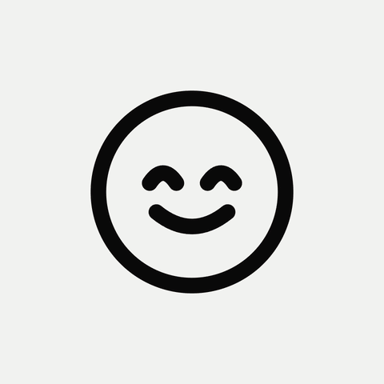

# Glass

Drop a logo, get it back as a glass app icon. Live at [phileeppov.com/glass](https://phileeppov.com/glass), where changes land first. I designed it and built it with Claude Code.



Upload an SVG or PNG, drop it on the page, paste one from Figma, or type a letter, a word or an emoji. Out comes a 1080p video, square or 16:9, or a PNG: 1024 or 2048 px, an avatar for round profile pictures, or a square App Store icon. Everything runs in the browser, so the logo never leaves it.

Turn on Sound and the glass reacts to the demo tune, your mic or your own track. Bass bends the red end of the fringe, highs the violet one, and kicks send a ripple through the glass. The video keeps the sound too.

## How it works

One fragment shader in WebGL 1. The logo becomes a signed distance field ([`src/sdf.js`](src/sdf.js)), so where the glass magnifies it, the edge stays smooth instead of going blocky. The rim pulls the logo out to the edge, and each pixel there averages 32 samples across the spectrum, every color bent a little differently, which is where the rainbow fringe comes from ([`src/renderer.js`](src/renderer.js)).

Sound goes through Web Audio: eight frequency bands, 40 Hz to 12 kHz, each tied to its own stretch of the rainbow fringe, plus the beats ([`src/sound.js`](src/sound.js)). The demo tune is struck glass, a few sine partials per note, rendered in the browser ([`src/tune.js`](src/tune.js)).

## Run it

No build step and no dependencies. From the repo folder, start any static server, for example:

```bash
python3 -m http.server 8000
```

Then open http://localhost:8000 (on Windows the command is `python`). Opening `index.html` straight from disk won't work: most browsers block ES modules on `file://`.

## License

MIT for the code. The Onest font in `fonts/` is under the SIL Open Font License, see [`fonts/OFL-Onest.txt`](fonts/OFL-Onest.txt).
