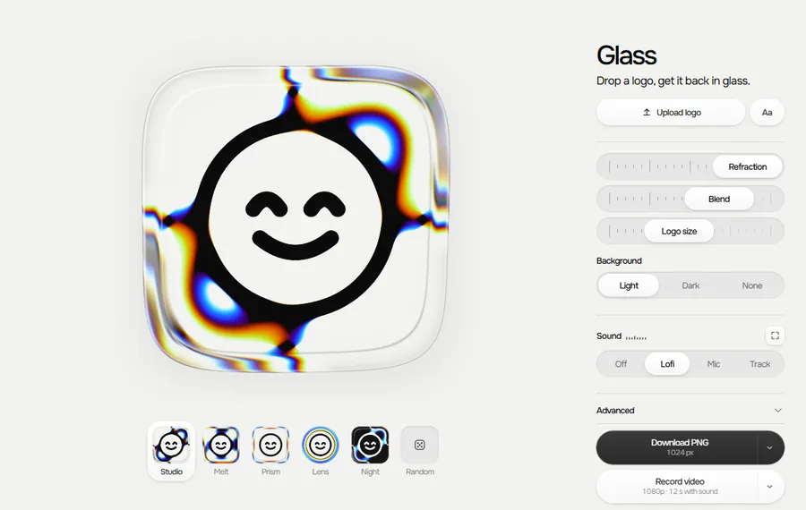

# Glass

Play your logo like a handpan. Each tap rings a note, and music moves the glass on the beat.



Try it at [phileeppov.com/glass](https://phileeppov.com/glass). Upload an SVG, PNG or JPG, paste from Figma, or type a word or an emoji, then pick one of five presets or roll a random look. Out comes an icon: a PNG up to 2048 px or a 1080p video, with sound if it's on.

The glass is a single fragment shader and the sound is Web Audio, with the lofi loop and the notes synthesized in the browser. Your logo stays on your device. I designed it and built it with Claude Code.

## Run it

No build step. Serve the folder with any static server, for example:

```bash
python3 -m http.server 8000
```

Then open http://localhost:8000. On Windows the command is `python`. Opened straight from disk, the page shows no glass: most browsers block ES modules on `file://`.

This repo sends nothing anywhere. On phileeppov.com a small script counts events like `png` or `sound:mic`, never a logo or a file.

MIT for the code. The Onest font in `fonts/` is under the [SIL Open Font License](fonts/OFL-Onest.txt).
